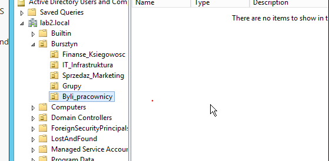
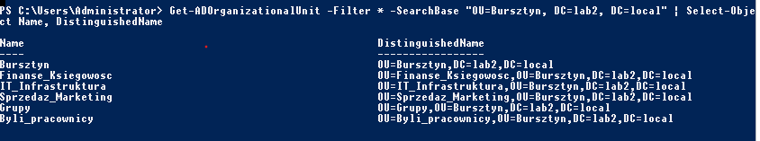

### Day 1 – OU structure and groups
- Created a company OU 'Bursztyn' with department OUs: 'Finanse_Ksiegowosc' (Finance & Accounting),
  'IT_Infrastruktura' (IT Infrastructure), 'Sprzedaz_Marketing` (Sales & Marketing)
- Separate OUs for groups ('Grupy') and former employees ('Byli_pracownicy')
- Enabled protection from accidental deletion on all OUs
- Created a Global Security group for each department
- Verified the structure with PowerShell ('Get-ADOrganizationalUnit', 'Get-ADGroup')

**OU structure in Active Directory Users and Computers:**

**Verification with PowerShell:**

## Issues encountered
- OU created in the wrong location: IT_Infrastruktura was accidentally created inside
  Finanse_Ksiegowosc instead of Bursztyn. Because the OU was protected from accidental deletion,
  it could not be removed or moved right away. Fix: enabled View → Advanced Features, disabled the
  protection in the OU's Object tab, moved the OU to the correct location, and re-enabled the protection.
- On Server 2012 R2, the ProtectedFromAccidentalDeletion property returned empty or invalid
  when requested via -Properties. Protection was verified in the GUI (Object tab) instead.

