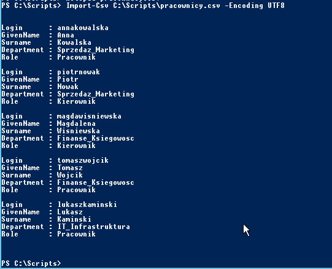
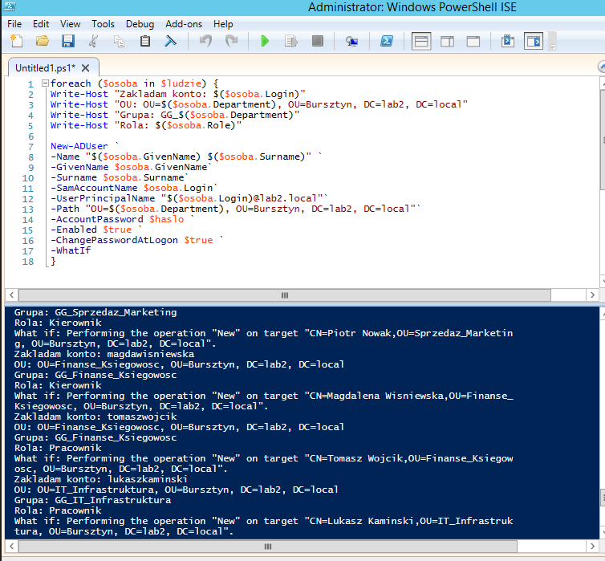
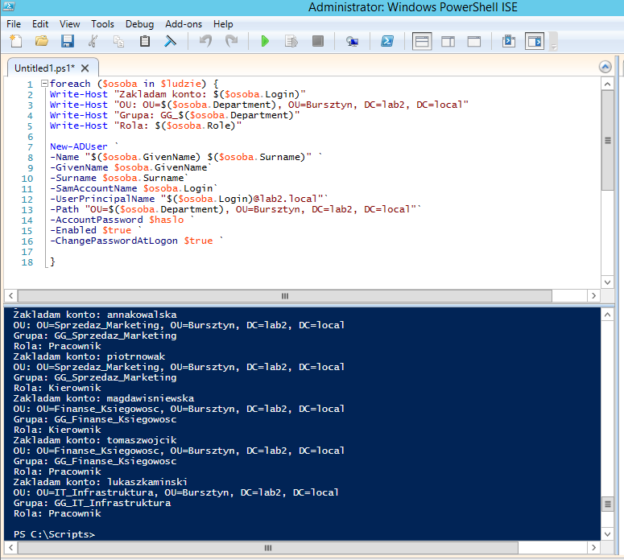
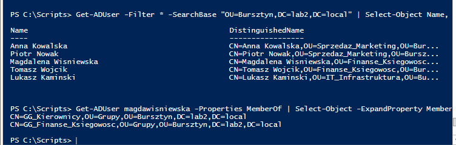
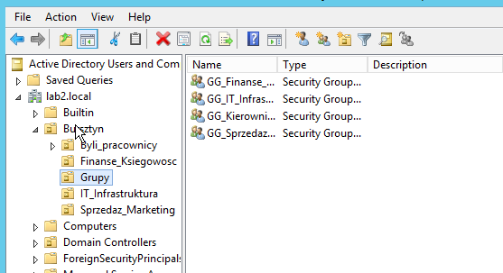
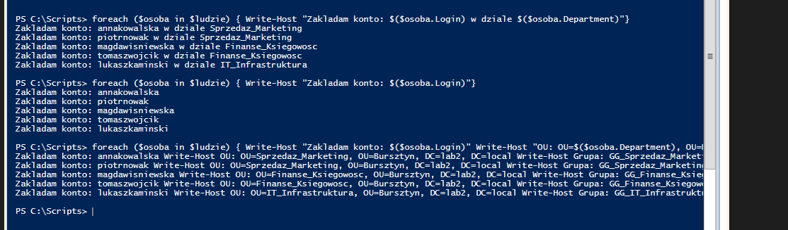
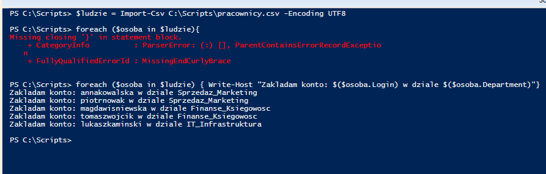

### Day 2 · Bulk user creation from CSV (PowerShell)

Today's goal sounded simple. Take a list of new employees (the kind of file HR would send) and create all the accounts at once with a script instead of clicking through ADUC over and over.

#### How it went

First I made a folder `C:\Scripts` on DC02 so all my automation files live in one place.

Then I picked what info each account needs and turned it into a proper CSV with `Login, GivenName, Surname, Department, Role`. I saved it as UTF-8 and checked with `Import-Csv` that PowerShell actually reads it.

   
  The CSV loaded in PowerShell. Every row turned into its own "employee card"

I also needed a place for managers so I created a new group `GG_Kierownicy` in the `Grupy` OU.

The script `import-users.ps1` goes through every person in the file and:
1. creates the account in the right department OU with `New-ADUser`
2. adds them to their department group `GG_<Department>`
3. also adds them to `GG_Kierownicy` if their role is Kierownik
4. sets a temporary password they have to change at first logon

I didn't run it for real straight away. I tested it in three steps:
1. a dry run with `Write-Host` just to see if the data, paths and group names looked right
2. `New-ADUser -WhatIf` where AD checks everything but creates nothing
3. the real run 🎉

<table>
  <tr>
    <td align="center">
       
      WhatIf: AD tells me what it would do
    </td>
    <td align="center">
       
      First real run: accounts created, no groups yet
    </td>
  </tr>
  <tr>
    <td align="center">
       
      After the real run: 5 accounts in the right OUs and Magdalena in both groups
    </td>
    <td align="center">
       
      All four groups in ADUC with the new GG_Kierownicy
    </td>
  </tr>
</table>

#### Why I did it this way

Passwords were the part I had to think about the most. My first idea was to just add a password column to the CSV. Then I realised a file like that usually travels by email and sits on someone's disk. Anyone who opens it knows every new employee's password. Not great.

My second idea was surname + a keyboard pattern like `1qazXSW@`. Turns out patterns like that are in the password lists attackers use. So that was a no too.

For the lab I went with one temporary password and "change password at next logon". In a real company passwords would most likely be generated randomly for each person. That's something I want to try in v2.

The `Department` column uses exactly the same names as my OUs and groups. That way the script builds both the OU path and the group name (`GG_` + department) from one value.

Permissions go through groups and not single accounts. A manager gets extra access just by being in `GG_Kierownicy`.

#### Things that broke (and what I learned)

Honestly this part took longer than the script itself 😅

**The `>>` prompt.** I forgot to close a quote in `-Filter` and PowerShell just sat there waiting for more. `Ctrl + C` gets you out.

**Missing `}`.** Typing a loop over several lines in the console ended with a missing brace error. That's when I moved to PowerShell ISE which is way nicer for writing scripts.

**Properties inside text.** I first wrote `"$osoba.Login"` which would print the whole object instead of the login. You need `"$($osoba.Login)"` so PowerShell works out the value first.

**New lines in output.** I tried `\n` (Linux habit) and also put two `Write-Host` in one line. The second one just got printed as text. In PowerShell every `Write-Host` already starts a new line so I put each one on its own line.

**The backtick.** One missing space before the backtick after `$true` and I got *Cannot convert System.String to Boolean*. On top of that `-WhatIf` was treated as a separate command. One space. ONE. Lesson learned.

**"The specified account already exists".** That's what you get when you run the script twice. It doesn't check for existing users yet so that's on the v2 list.

📸 Screenshots of my errors

<table>
  <tr>
    <td align="center">
       
      Two Write-Host in one line printed as plain text
    </td>
    <td align="center">
       
      Missing closing brace in the console
    </td>
  </tr>
</table>

#### Next time (v2)
1. check if a user already exists before creating it
2. a random password for each user
3. splatting instead of backticks so I never have to deal with that space again
4. save the results to a log file
