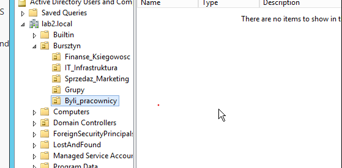
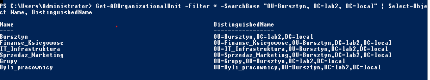

# ad-homelab-bursztyn
> **Status: On hold** — paused due to temporary lack of access to my
> lab machine. Currently working on [Linux / Debian Lab](link-do-repo).

## About
A simulation of IT helpdesk tasks in a small fictional company, Bursztyn Sp. z o.o.
(3 departments, 10 employees), built on Windows Server 2012 R2 in VirtualBox.

## Environment
- Domain controller: DC02 ('lab2.local')
 - Workstation: to be added, 
- VirtualBox, NAT network

## Roadmap
- [x] OU structure and security groups
- [ ] Bulk user creation from CSV (PowerShell)
- [ ] Shared department folder with group-based permissions
- [ ] New employee onboarding (template account)
- [ ] Employee offboarding
- [ ] Ticket: password reset and account unlock
- [ ] System State backup (Windows Server Backup) and restore test

## Progress

### Day 1 – OU structure and groups
- Created a company OU 'Bursztyn' with department OUs: 'Finanse_Ksiegowosc' (Finance & Accounting),
  'IT_Infrastruktura' (IT Infrastructure), 'Sprzedaz_Marketing` (Sales & Marketing)
- Separate OUs for groups ('Grupy') and former employees ('Byli_pracownicy')
- Enabled protection from accidental deletion on all OUs
- Created a Global Security group for each department
- Verified the structure with PowerShell ('Get-ADOrganizationalUnit', 'Get-ADGroup')

**OU structure in Active Directory Users and Computers:**

**Verification with PowerShell:**

## Issues encountered
- OU created in the wrong location: IT_Infrastruktura was accidentally created inside
  Finanse_Ksiegowosc instead of Bursztyn. Because the OU was protected from accidental deletion,
  it could not be removed or moved right away. Fix: enabled View → Advanced Features, disabled the
  protection in the OU's Object tab, moved the OU to the correct location, and re-enabled the protection.
- On Server 2012 R2, the ProtectedFromAccidentalDeletion property returned empty or invalid
  when requested via -Properties. Protection was verified in the GUI (Object tab) instead.
